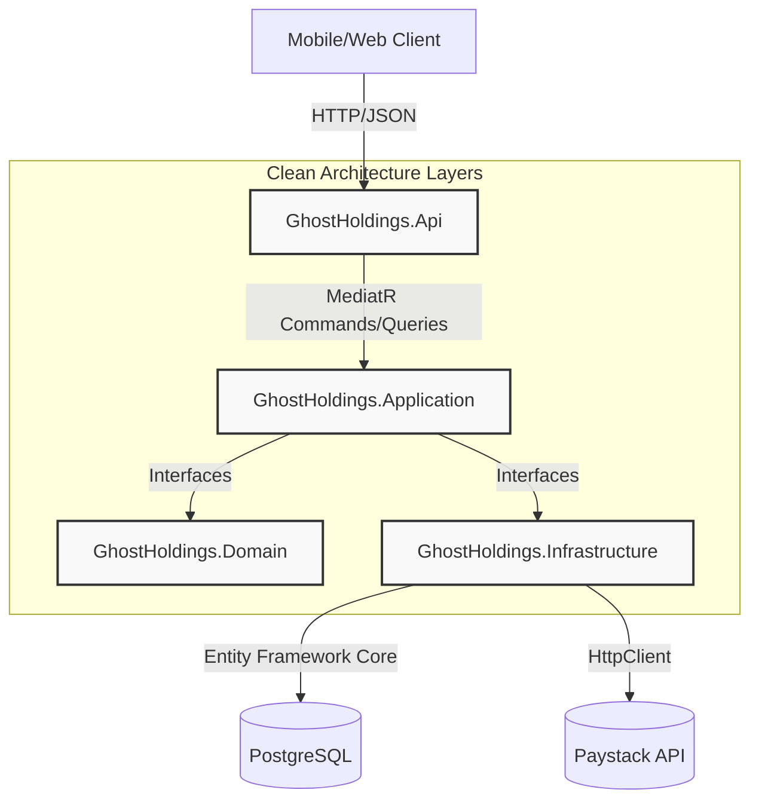

# 🏦 GhostHoldings API - Enterprise Fintech Backend

[](https://dotnet.microsoft.com/)
[](https://www.postgresql.org/)
[](https://www.docker.com/)
[](LICENSE)

A high-performance, secure, and scalable fintech backend designed for mobile money (M-Pesa) integrations. Built with **Clean Architecture**, this system handles complex financial workflows including dynamic fee calculation, auto-chunked large transfers, cryptographic webhook verification, and a comprehensive Maker-Checker admin governance model for KYC and transaction oversight.

---

## 🚀 Key Features

- 💳 **Paystack M-Pesa Integration**: Seamless deposit initiation (STK Push) and automated withdrawal payouts.
- 🔀 **Auto-Chunking Engine**: Automatically splits large withdrawals (>KES 150,000) into compliant, multi-transaction chunks to respect payment gateway limits.
- 🛡️ **Maker-Checker Admin Portal**: Secure administrative endpoints for reviewing pending requests, executing audited reversible refunds, and managing user compliance.
- 🪪 **KYC & Compliance Workflow**: End-to-end Know Your Customer (KYC) document submission, admin review queue, and immutable audit trails (`ReviewedByAdminId`, `ReviewedAt`).
- ⚖️ **Dynamic Fee Engine**: Calculates Safaricom-style tiered withdrawal fees dynamically with pro-rata distribution across chunked transactions.
- 🔒 **Enterprise Security**: BCrypt password hashing, JWT authentication, and HMAC-SHA512 cryptographic signature verification for all incoming webhooks.
- ⏱️ **Business Rule Enforcement**: Timezone-aware (EAT) withdrawal restrictions (Tuesdays & Thursdays only) and strict min/max limits.
- 🐳 **Production-Ready Deployment**: Multi-stage Dockerfile, non-root user execution, and automated EF Core migrations on startup.

---

## 🏗️ Architecture

This project strictly adheres to **Clean Architecture** principles, ensuring separation of concerns, high testability, and framework independence.



### Layer Responsibilities:
1. **Domain**: Pure C# business logic, entities (`User`, `Wallet`, `Transaction`, `KycSubmission`), and domain exceptions. Zero external dependencies.
2. **Application**: Use cases, MediatR handlers, DTOs, and interfaces. Orchestrates the business flow.
3. **Infrastructure**: External concerns. EF Core `DbContext`, Paystack API HTTP client implementations, and BCrypt hashing.
4. **API**: ASP.NET Core controllers, JWT middleware, and dependency injection setup.

---

## 🛠️ Tech Stack

| Category | Technology |
| :--- | :--- |
| **Language & Framework** | C# 13, .NET 10, ASP.NET Core |
| **Database & ORM** | PostgreSQL 15+, Entity Framework Core |
| **Architecture Pattern** | Clean Architecture, CQRS (via MediatR) |
| **Authentication** | JWT (JSON Web Tokens), BCrypt |
| **External APIs** | Paystack (M-Pesa Mobile Money) |
| **DevOps & Deployment** | Docker, GitHub Actions (CI/CD), Render.com |

---

## ⚙️ Getting Started (Local Development)

### Prerequisites
- [.NET 10 SDK](https://dotnet.microsoft.com/download)
- [PostgreSQL](https://www.postgresql.org/download/) (or Docker)
- [Git](https://git-scm.com/)

### 1. Clone the Repository
```bash
git clone https://github.com/ghostwipe-png/GhostHoldings.git
cd GhostHoldings
```

### 2. Configure Environment
Update `GhostHoldings.Api/appsettings.json` with your local database connection string and Paystack test keys:
```json
{
  "ConnectionStrings": {
    "DefaultConnection": "Host=localhost;Port=5432;Database=ghostholdings_dev;Username=postgres;Password=your_password"
  },
  "Paystack": {
    "SecretKey": "sk_test_your_paystack_secret_key",
    "PublicKey": "pk_test_your_paystack_public_key"
  }
}
```

### 3. Apply Database Migrations
```bash
cd GhostHoldings.Api
dotnet ef database update --project ../GhostHoldings.Infrastructure
```

### 4. Run the API
```bash
dotnet run
```
*The API will be available at `http://localhost:5232`*

---

## 📡 API Endpoints Overview

| Method | Endpoint | Description | Auth Required |
| :--- | :--- | :--- | :---: |
| `POST` | `/api/v1/auth/register` | Register a new user | ❌ |
| `POST` | `/api/v1/auth/login` | Authenticate and get JWT | ❌ |
| `GET` | `/api/v1/wallet/balance` | Fetch wallet balance & recent txns | ✅ |
| `POST` | `/api/v1/deposit/initiate` | Trigger M-Pesa STK Push | ✅ |
| `POST` | `/api/v1/withdrawal/initiate` | Request withdrawal (auto-chunks >150k) | ✅ |
| `POST` | `/api/v1/webhook/paystack` | Receive & verify Paystack events | 🔐 (HMAC Signature) |
| `POST` | `/api/v1/kyc/submit` | Submit KYC documents for review | ✅ |
| `GET` | `/api/v1/admin/pending-kyc` | Fetch pending KYC submissions | ✅ (Admin Only) |
| `POST` | `/api/v1/admin/review-kyc` | Approve/Reject KYC submissions | ✅ (Admin Only) |
| `POST` | `/api/v1/admin/refund-transaction`| Reverse a failed withdrawal | ✅ (Admin Only) |

---

## 🐳 Docker & Production Deployment

This project is optimized for cloud deployment. It uses a multi-stage Docker build to keep the final image lightweight and secure.

```bash
# Build the production image
docker build -t ghostholdings-api .

# Run locally (maps to port 8080)
docker run -p 8080:8080 \
  -e ConnectionStrings__DefaultConnection="Host=db;Port=5432;..." \
  -e Paystack__SecretKey="sk_test_..." \
  ghostholdings-api
```

**Live Production Instance**:  
🌍 [https://ghostholdings.onrender.com](https://ghostholdings.onrender.com)  
*(Note: Free tier instances may experience a ~30s cold start on the first request).*

---

## 🤝 Contributing

Contributions, issues, and feature requests are welcome! Feel free to check the [issues page](https://github.com/ghostwipe-png/GhostHoldings/issues).

---

## 📜 License

This project is licensed under the MIT License - see the [LICENSE](LICENSE) file for details.

---
*Built with ❤️ and Clean Architecture principles.*